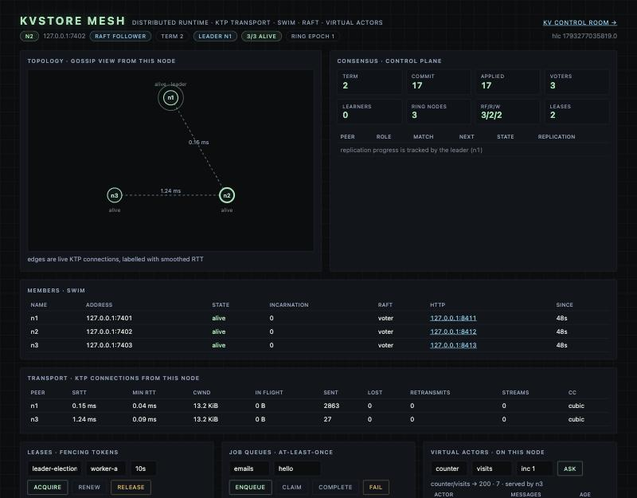

# KVStore

A **distributed systems runtime and networking stack**, written from scratch,
with a replicated key-value store as its first application. **C, Rust and Go**,
each in the layer it fits; the Go tier is standard library only.

KVStore 1.x was a quorum-replicated KV store behind a single gateway. 2.0 turns
that gateway into a mesh: every node runs its own encrypted transport protocol,
gossip membership, a Raft control plane, a virtual-actor runtime and a KV
coordinator, and any node serves any request.

```
                       HTTP: KV API · /mesh · /lease · /jobs · /actor · /registry
   ┌──────────────────────────────────────────────────────────────────────────────┐
   │ kvmesh node (Go) ×N — every node is a full peer                              │
   │                                                                              │
   │  runtime/   KV coordinator ◄─ ring ── control plane (Raft FSM: ring, leases   │
   │                                        + fencing tokens, job queues, registry)│
   │             virtual actors ◄─ placement ── SWIM membership (Lifeguard)        │
   │             hybrid logical clocks · HLC-ordered event log                     │
   │                                                                              │
   │  netstack/  rpc (calls over streams) · endpoint (one UDP socket)              │
   │             KTP: 1-RTT X25519/Ed25519 handshake, AES-GCM, multiplexed         │
   │             streams, flow control, RFC 9002 recovery, NewReno/CUBIC/BBR       │
   └───────┬──────────────────────────┬──────────────────────────┬────────────────┘
           │ KTP/UDP between kvmesh nodes (gossip, Raft, actor calls)   ▲
           │ TCP to storage nodes                                       │ SWIM
   ┌───────▼─────┐   ┌─────────────┐   ┌─────────────┐
   │ kvnode      │   │ kvnode      │   │ kvnode      │   Rust daemon, one per disk
   │  └ FFI      │   │  └ FFI      │   │  └ FFI      │
   │ libkvengine │   │ libkvengine │   │ libkvengine │   C: mmap'd hash table, versioned slots
   └─────────────┘   └─────────────┘   └─────────────┘
```



**What you get**

- **KTP**, a QUIC-style transport over UDP (`netstack/ktp`): one-round-trip
  mutually authenticated handshake bound to a cluster key, AEAD-sealed packets,
  multiplexed streams and datagrams, credit flow control, ACK ranges and
  RFC 9002 loss recovery, and three congestion controllers — NewReno, CUBIC and
  **BBR** (moves data ~8× faster than NewReno at 2% random loss).
- **SWIM** membership with Lifeguard (`runtime/swim`): suspicion, incarnations,
  refutation, piggybacked gossip, push-pull, partition healing.
- **Raft** (`runtime/raft`): pre-vote, check-quorum, ReadIndex, snapshots,
  membership changes, leadership transfer, a CRC-framed WAL — checked against
  Raft's safety invariants under 120 seeds of partitions and crashes.
- A **control plane** on Raft (`runtime/control`): the one storage ring every
  coordinator serves, **leases with fencing tokens**, **job queues** with
  visibility timeouts and token-fenced completion, a linearizable registry.
- **Virtual actors** (`runtime/actor`): activated on demand on their owner,
  turn-based, migrating with their state when nodes die, fenced by CAS.
- The **KV store** from 1.x, now served by every node, with its ring adopted
  from the control plane — plus the 1.x single-gateway mode, unchanged.

The design contract is [`docs/ARCHITECTURE.md`](docs/ARCHITECTURE.md); every
package's `doc.go` explains its protocol.

## Build

Requires `cc` (clang or gcc), `cargo` (Rust 1.70+), and `go` (1.25+).

```sh
make all          # C lib, Rust node, Go gateway/kvmesh/ktpcat + CLI -> bin/
make test         # C engine + cargo test + go test -short + go vet + JS client
make test-race    # runtime + networking stack under the race detector
make chaos        # the seeded fault-injection suites at full size
make fuzz-smoke   # every Fuzz target for a few seconds (FUZZTIME=10s)
make mesh-demo    # 3 storage nodes + 3 kvmesh nodes on UDP; kill -9 the leader
make demo         # the 1.x single-gateway demo
```

## Single-gateway demo (1.x)

`make demo` starts four nodes and a gateway (`RF=3, R=2, W=2`), then **kills a
replica mid-flight** and shows reads and writes still succeed (a hint is stored
for the dead node). Bringing the node back shows **hinted handoff** plus
**read-repair**:

```
== FAULT TOLERANCE: killing replica 127.0.0.1:7071 (one of hello's three)
   heartbeat should mark it down; a read still succeeds from the survivors:
HTTP/1.1 200 OK
X-KV-Responders: 127.0.0.1:7073,127.0.0.1:7072
X-KV-Version: 1
   and so does a write — 2 of 3 replicas is still a W=2 quorum:
ok v5 acks=2/2 replicas=[127.0.0.1:7071,127.0.0.1:7073,127.0.0.1:7072]

== hinted handoff + read-repair: bring 127.0.0.1:7071 back
HTTP/1.1 200 OK
X-KV-Repaired: 127.0.0.1:7071
X-KV-Version: 5
```

## Mesh demo

`make mesh-demo` (or `scripts/mesh-demo.sh`) starts three storage nodes and
three `kvmesh` nodes on real UDP sockets, then a fourth. Output from a real run:

```
== mesh tier: 3 kvmesh nodes bootstrapping a Raft control plane over KTP/UDP
   members: n1=alive, n2=alive, n3=alive
   raft: leader n1, term 2, voters n1,n2,n3
   storage ring (from the control plane): epoch 1 127.0.0.1:7170,127.0.0.1:7171,127.0.0.1:7172
== KV: write through n1, read through n3 (no single gateway)
   PUT /kv/hello via n1 -> 204
   GET /kv/hello via n3 -> world
== leases with fencing tokens (Raft-replicated)
   alice: token 6 (holder alice)
   bob:   HTTP 409 (conflict)
== virtual actor: one counter, asked through every node
   via n1: counter=1  (activated on n3)  ...  via n1: counter=4  (activated on n3)
== fault: kill -9 the actor's owner (n3) and the control-plane leader (n1)
   control plane: re-elected, leader n2 (term 3)
   counter=5 (re-activated on n1) after 8s
   SWIM on n2: n1=alive, n2=alive, n3=dead
   GET /kv/hello via n2 -> world
   bob still cannot take alice's lease after failover: HTTP 409
== elastic: n4 joins via gossip, is added as a Raft learner, then promoted
   voters: n1,n2,n3,n4  learners: -
```

## Running a mesh

```sh
# storage nodes (as in 1.x)
for i in 0 1 2; do bin/kvnode --listen 127.0.0.1:707$i --db /tmp/kv$i.db & done

# three founding kvmesh nodes; every founder gets the same --bootstrap list
BOOT=n1=127.0.0.1:7101,n2=127.0.0.1:7102,n3=127.0.0.1:7103
for i in 1 2 3; do
  bin/kvmesh --name n$i --listen 127.0.0.1:710$i --http 127.0.0.1:810$i \
    --data /tmp/mesh-n$i --cluster-key s3cret --bootstrap $BOOT \
    --kvnodes 127.0.0.1:7070,127.0.0.1:7071,127.0.0.1:7072 &
done

# later: a node joins through any member; it becomes a learner, then a voter
bin/kvmesh --name n4 --listen 127.0.0.1:7104 --http 127.0.0.1:8104 \
  --data /tmp/mesh-n4 --cluster-key s3cret --join 127.0.0.1:7101 &

open http://127.0.0.1:8101/mesh      # mesh control room (KV dashboard at /dashboard)
```

Every node serves the full 1.x KV API plus:

| route | what |
|---|---|
| `GET /mesh/status` | members, Raft, ring, leases, queues, KTP connections, actors, RPC stats, event log |
| `GET /mesh/metrics` | Prometheus gauges: members, term, commit, leader, ring epoch, per-peer RTT/cwnd/loss |
| `POST /mesh/raft/transfer?to=` | hand control-plane leadership to a node |
| `POST /lease/{name}?holder=&ttl=` | acquire (`&renew=1&token=` to renew); returns the fencing token |
| `DELETE /lease/{name}?holder=&token=` · `GET /leases` | release · list (linearizable) |
| `POST /jobs/{q}` (body = payload, `?id=` for idempotency) | enqueue |
| `POST /jobs/{q}/claim?worker=&visibility=30s` | claim the oldest ready job: `{id, payload, token, attempt}` |
| `POST /jobs/{q}/{id}/complete\|fail\|extend?token=` | finish, retry with backoff (dead-letter after max attempts), or extend |
| `GET\|PUT /registry/{key}` | linearizable metadata (`If-Match` for CAS) |
| `POST /actor/{type}/{key}` (body = message) | ask a virtual actor (`counter`: `inc N`/`get`; `ledger`: append) |
| `POST /admin/nodes?addr=` · `DELETE /admin/nodes/{addr}` | change the storage ring — through Raft, so every node adopts it |

And the CLI speaks it: `kvstore --gw http://127.0.0.1:8101 mesh`, `lease acquire
primary alice 30s`, `jobs claim emails w1`, `actor counter visits inc`.

**Why the ring lives in Raft.** In 1.x each gateway kept its own node list. Two
gateways with different lists pick different replica sets, so a write quorum on
one and a read quorum on the other need not overlap — `R + W > RF` silently
stops meaning anything. In 2.0 the ring is a Raft-replicated value with an epoch
(changes are compare-and-set on the epoch), and coordinators only ever move
forward to newer epochs.

## The networking stack: KTP

`ktpcat` is netcat and a benchmark for KTP, including an in-process mode over a
simulated link that traces the congestion controller as it runs:

```sh
bin/ktpcat -l 127.0.0.1:9000 &                      # server
bin/ktpcat -bench 64MiB 127.0.0.1:9000              # goodput, RTT, cwnd, loss
bin/ktpcat -sim -loss 0.02 -latency 20ms -bw 20MB -bench 64MiB -cc bbr
```

Measured with `-sim` on a 20 MB/s (160 Mbit/s) link, 40ms RTT, 256 KB router queue:

| | clean link | 2% random loss |
|---|---|---|
| NewReno | 103 Mbit/s | 1.8 Mbit/s |
| CUBIC | 130 Mbit/s | 1.7 Mbit/s |
| BBR | 143 Mbit/s | 122 Mbit/s |

Loss-based controllers read every random drop as congestion and halve their
window (the Mathis bound, ≈ 1.22·MSS / (RTT·√p)); BBR models the path from
delivery-rate samples and ignores loss that isn't caused by its own queue. KTP
keeps NewReno as the library default (it is the RFC baseline), `kvmesh` uses
CUBIC (`--cc` changes it), and `ktpcat` defaults to BBR.

Wire format, handshake and recovery are documented in
[`kvgw/netstack/ktp/doc.go`](kvgw/netstack/ktp/doc.go).

## Testing the hard parts

Every protocol core is a **sans-IO state machine** — no sockets, clocks or
goroutines; time and randomness are parameters — so the tests drive whole
clusters deterministically from a seed and replay failures exactly:

- **Raft**: a simulated 5-node cluster with message loss, duplication,
  reordering, partitions and crash/restart from durable storage, checking
  election safety, log matching, leader completeness, state-machine safety and
  commit monotonicity after every step: 120 seeds, ~800 elections, ~70,000
  acknowledged proposals, all converged and none lost.
- **SWIM**: 5–32 node clusters converge; crashes are detected everywhere with
  no false positives; 10 minutes at 10% loss with zero false deaths; partitions
  heal; same seed, same event trace.
- **KTP**: byte-exact 8-stream transfers at 0/1/5/20% loss with duplication,
  reordering and bit flips, for every congestion controller; RTT and congestion
  maths checked against the RFCs.
- **Control plane**: model-based lease exclusion and fencing; replicas fed the
  same log end byte-identical; snapshot-at-a-random-point equivalence.
- **Actors**: turn-based execution under 200 concurrent callers; split brain
  (two nodes both owning an actor) loses no acknowledged update.
- **Full stack**: whole meshes on `simnet` inside `testing/synctest` (virtual
  time): crash the actor's host and the Raft leader, check failover.
- **Fuzzing**: every network-facing decoder (KTP packets and frames behind
  authentication, Raft messages, SWIM gossip, RPC frames, control commands).
  Fuzzing found two real Raft crashes on malformed messages, now validated away.

## Use it manually (single gateway, 1.x)

```sh
# 4 storage nodes
for i in 0 1 2 3; do
  bin/kvnode --listen 127.0.0.1:707$i --db /tmp/kvstore-node-$i.db --capacity 1024 &
done

# gateway: replicate each key to 3 nodes, 2 acks to write, 2 responses to read.
# --anti-entropy turns on a background repair sweep (heal without a read).
# --heartbeat (default 2s) pings nodes and replays hints.
bin/gateway --listen :8090 \
  --nodes 127.0.0.1:7070,127.0.0.1:7071,127.0.0.1:7072,127.0.0.1:7073 \
  --rf 3 --read 2 --write 2 --anti-entropy 5s --heartbeat 2s &

# drive it
bin/kvstore --gw http://127.0.0.1:8090 put hello world
bin/kvstore --gw http://127.0.0.1:8090 get hello       # -> world (v1 from [..])
bin/kvstore --gw http://127.0.0.1:8090 route hello     # -> the 3 replicas
bin/kvstore --gw http://127.0.0.1:8090 scan
bin/kvstore --gw http://127.0.0.1:8090 scan hel        # prefix scan
bin/kvstore --gw http://127.0.0.1:8090 health
bin/kvstore --gw http://127.0.0.1:8090 compact         # GC tombstones on live nodes
bin/kvstore --gw http://127.0.0.1:8090 watch hello     # poll get until Ctrl-C
bin/kvstore --gw http://127.0.0.1:8090 rm-prefix hel   # delete keys starting with hel
bin/kvstore --gw http://127.0.0.1:8090 fault 127.0.0.1:7071 on
```

Or with `curl` (response headers are `X-KV-*`; `X-Triglot-*` is still accepted
on requests for one release):

```sh
curl -i -X PUT --data-binary 'world' http://127.0.0.1:8090/kv/hello
curl -i http://127.0.0.1:8090/kv/hello
curl    http://127.0.0.1:8090/scan
curl    'http://127.0.0.1:8090/scan?prefix=hel'
curl -X DELETE 'http://127.0.0.1:8090/scan?prefix=hel'
curl -X POST 'http://127.0.0.1:8090/admin/fault?addr=127.0.0.1:7071&down=1'
curl    http://127.0.0.1:8090/route/hello
```

## Compare-and-set

Writes are last-writer-wins. When you need "write this only if nobody else has",
use CAS: the coordinator peeks the winning version and applies the put only if
it matches. Expected version `0` means the key must not exist (create-if-absent).
Otherwise you get a conflict and the stored value is unchanged.

```sh
# after a get (or put) the version is in X-KV-Version / the CLI note
bin/kvstore --gw http://127.0.0.1:8090 cas hello 1 world-v2
curl -i -X PUT --data-binary 'world-v3' \
  -H 'If-Match: 2' http://127.0.0.1:8090/kv/hello
# stale version → HTTP 409
curl -i -X PUT --data-binary 'nope' \
  -H 'X-KV-CAS: 1' http://127.0.0.1:8090/kv/hello
```

## TTL (native engine field)

TTL is stored as `expires_at` (unix seconds, 0 = never) on the C slot. New
writes use `PUTX` on the wire. Values previously wrapped as `KVTTL1\n` /
`TGTTL1\n` envelopes still decode on read.

```sh
bin/kvstore --gw http://127.0.0.1:8090 put session token --ttl 10s
curl -i -X PUT --data-binary 'token' -H 'X-KV-TTL: 10' \
  http://127.0.0.1:8090/kv/session
bin/kvstore --gw http://127.0.0.1:8090 expire session 30s
```

Get treats an expired key as not found and tombstones it (lazy in C, plus
read-repair). Scan omits expired keys. The optional `--anti-entropy` sweep
also deletes them.

## Hinted handoff and heartbeat

When a replica in the preference list misses a write, the coordinator stores a
**hint** `{addr, key, value, version, expires, op}` and still succeeds if the
remaining replicas make `W`. A **heartbeat** loop (default 2s) pings every
node, tracks `down` / `last_ok` **without removing anyone from the ring**
(preference lists stay stable), skips known-down replicas on the write path
instead of waiting out the full timeout, and **replays hints** when the node
answers again.

`GET /health` includes `down` and `last_ok` per node, plus `hints_pending`
(queued, not yet replayed), `capacity`, and `load` (`count/capacity`). Metrics
expose `hints_stored` / `hints_replayed` / `compacts` / `prefix_deletes`, plus
EWMA `latency_get_ms` / `latency_put_ms`. Nodes include `forced` when an
operator has injected a fault.

## Compact (tombstone GC)

Deletes leave versioned tombstones. `kv_compact` rehashes a node at the same
capacity so tombstones and expired keys are dropped without growing the table.
The coordinator's `CompactAll` is best-effort across every live node.

```sh
bin/kvstore --gw http://127.0.0.1:8090 compact
curl -X POST http://127.0.0.1:8090/admin/compact
```

The dashboard Compact button hits the same endpoint.

## Prefix delete

`DeletePrefix` scans live keys starting with a prefix and tombstones each with
a new version (best-effort quorum). Empty prefix is a full scan, same as the
engine.

```sh
bin/kvstore --gw http://127.0.0.1:8090 rm-prefix sess
curl -X DELETE 'http://127.0.0.1:8090/scan?prefix=sess'
```

The dashboard **delete prefix** button (confirm) uses the current filter box.

## Fault injection

`ForceDown(addr, true)` marks a node down for writes without taking it off the
ring — the same skip-and-hint path as a failed heartbeat. Heartbeat **must
not** mark that node up until `ForceDown(addr, false)`.

```sh
bin/kvstore --gw http://127.0.0.1:8090 fault 127.0.0.1:7071 on
curl -X POST 'http://127.0.0.1:8090/admin/fault?addr=127.0.0.1:7071&down=1'
# …later
bin/kvstore --gw http://127.0.0.1:8090 fault 127.0.0.1:7071 off
```

Each node card on the dashboard has a **fault** / **heal** toggle.

## CLI watch

`kvstore watch KEY` polls `GET /kv/{key}` every second until Ctrl-C and prints
the version and value (or `(missing)`).

```sh
bin/kvstore --gw http://127.0.0.1:8090 watch hello
# v1 world
```

## Export / import

```sh
bin/kvstore --gw http://127.0.0.1:8090 export > snap.json
bin/kvstore --gw http://127.0.0.1:8090 import < snap.json

curl http://127.0.0.1:8090/export
curl -X POST --data-binary @snap.json http://127.0.0.1:8090/import
```

The document is `{ "entries": [{ "key", "value", "version", "expires_at"? }] }`.
Values are decoded (no envelope leaked). Import puts each live row and skips
already-expired ones. Versions are informational; import assigns new ones.

## Bench and metrics

```sh
bin/kvstore --gw http://127.0.0.1:8090 bench        # 200 put/get pairs
bin/kvstore --gw http://127.0.0.1:8090 bench 50
bin/kvstore --gw http://127.0.0.1:8090 metrics      # coordinator counters
```

## Docker

Four kvnodes + one gateway, dashboard published on **8090**:

```sh
docker compose up --build
curl http://127.0.0.1:8090/health
open http://127.0.0.1:8090/dashboard
```

Compose is written for Linux. On macOS the containers still run in a Linux VM
(Docker Desktop), so this usually works; if you hit awkward cgo/mmap issues
building **natively** on the host, use `make demo` instead.

## Consistency model

- **Placement**: rendezvous hashing scores every node for a key and takes the
  top `RF` as the preference list (replica set).
- **Writes**: the coordinator assigns a version greater than any it has seen
  (a Lamport-style clock, primed by a best-effort peek of the replicas), writes
  to all `RF` replicas, and needs `W` acks. Known-down replicas are skipped and
  receive a hint instead of a blocking RPC.
- **Reads**: query the replica set, need `R` responses, return the highest
  version. If `R + W > RF`, the read and write quorums always overlap, so a
  successful read observes the latest successful write.
- **Conflict resolution**: last-writer-wins by version, enforced in the C engine
  so writes are commutative and idempotent (safe to retry and replay).
- **Healing**: every read repairs replicas that are behind the winning version.
  Hinted handoff covers writes a replica missed while down. `--anti-entropy`
  sweeps live keys **and tombstones**.

## Growing and shrinking the cluster (live)

Nodes can join and leave a *running* cluster through admin endpoints — no
restart. Because placement is rendezvous hashing, adding a node only re-homes
~1/N of keys (onto the newcomer); the anti-entropy sweep (or the next read)
re-replicates them. Removing a node re-homes only its keys onto whoever the ring
picks next, and reads stay correct throughout.

```sh
curl :8090/admin/nodes                                   # current membership
curl -X POST ':8090/admin/nodes?addr=127.0.0.1:7073'     # join at runtime
curl -X DELETE :8090/admin/nodes/127.0.0.1:7070          # leave at runtime
```

The effective `RF/R/W` clamp to the live node count. Heartbeat marks a node
`down` but does **not** remove it from the ring.

## CRDT values (merge instead of overwrite)

Plain keys are last-writer-wins: two concurrent writes, one silently loses. For
counters and sets that's wrong — you want them to *merge*. The gateway exposes
**conflict-free replicated data types** whose merge is a lattice join
(associative, commutative, idempotent), coordinated by a per-key-locked
read-merge-write so concurrent updates all survive and replicas converge.

```sh
# PN-counter — fire 40 concurrent increments, get exactly 40 (no lost updates)
for i in $(seq 40); do curl -s -X POST :8090/crdt/counter/votes & done; wait
curl :8090/crdt/counter/votes                 # {"value":40}
curl -X POST ':8090/crdt/counter/votes?delta=-5'

# OR-set (observed-remove, add-wins)
curl -X POST ':8090/crdt/set/team?add=alice'
curl -X POST ':8090/crdt/set/team?add=bob'
curl -X POST ':8090/crdt/set/team?remove=bob'
curl :8090/crdt/set/team                       # {"members":["alice"]}
```

The merge laws are property-tested in [`internal/crdt`](kvgw/internal/crdt), and
a cluster test fires 50 concurrent increments through the real coordinator and
asserts none are lost.

## Live dashboard

The gateway serves a self-contained control room at `GET /dashboard` (no build
step, no dependencies). Charcoal / phosphor / amber / steel. Click a key row to
**inspect** it (value, version, replicas, expiry; JSON values are pretty-printed;
replica **route** list as pills from `/route/{key}`; loads put/get; get/del/route).
An **ops log** keeps the last ~24 actions. Put accepts CAS (`If-Match`). The
filter box calls `GET /scan?prefix=` when it looks like a prefix, with a confirm
**delete prefix**. Values toggle UTF-8 / hex. Each node shows heartbeat, keys,
tombs, a capacity/load bar, pending hints, and a **fault** toggle. Compact posts
`/admin/compact`. Metrics include get/put EWMA latency. A selected key is
re-fetched each refresh and flashes if its version changed.

```sh
open http://127.0.0.1:8090/dashboard
```

Counters are also at `GET /metrics` in Prometheus text format.

## Proving the KV layer

`internal/cluster/cluster_sim_test.go` is a small deterministic simulation /
linearizability checker. For each of 25 seeds it drives the **real coordinator**
through 250 randomized `put`/`get`/`del` operations while **continuously failing
a node**, and checks every successful read against a single-source-of-truth
model — then brings the cluster back and asserts read-repair has converged every
replica. Failures are reproducible from the seed.

```sh
go test ./kvgw/internal/cluster/ -run TestSimulation -v
```

[`cluster_chaos_test.go`](kvgw/internal/cluster/cluster_chaos_test.go) goes
further: a malicious scheduler randomly fails/heals nodes *and* grows/shrinks the
cluster at runtime while reads and writes flow, then asserts no committed value
was lost.

And the *protocol* itself is model-checked: [`spec/QuorumKV.tla`](spec/QuorumKV.tla)
is a TLA+ model of KVStore's R + W > N safety property, verified with TLC.

## Storage wire protocol (coordinator ↔ kvnode)

Length-prefixed binary, big-endian, designed to be readable in `tcpdump -X`.
Values carry an 8-byte version and an 8-byte `expires_at` (0 = never).

```
Request   GET      : 1B op  4B klen  key
          PUT      : 1B op  4B klen  key  8B version  4B vlen  val     (expires=0)
          PUTX     : 1B op  4B klen  key  8B version  8B expires  4B vlen  val
          DEL      : 1B op  4B klen  key  8B version
          SCAN     : 1B op
          SCAN_ALL : 1B op   (includes tombstones)
          PING     : 1B op
          STAT     : 1B op
          COMPACT  : 1B op   (GC at current capacity; no payload)
Response  1B status (0=ok 1=not_found 2=error 3=deleted)
GET ok       + 8B version  8B expires  4B vlen  val
GET deleted  + 8B version  8B expires
SCAN ok      + repeat(4B klen key 8B version 8B expires 4B vlen val), term klen=0xFFFFFFFF
SCAN_ALL ok  + repeat(4B klen key 8B version 8B expires 1B tomb 4B vlen val), term
STAT ok      + 4B count  4B capacity  8B max_version  4B tombstones
```

Ops: `1=GET 2=PUT 3=DEL 4=SCAN 5=PING 6=STAT 7=PUTX 8=SCAN_ALL 9=COMPACT`. See
[`kvnode/src/proto.rs`](kvnode/src/proto.rs) and
[`kvgw/internal/proto/proto.go`](kvgw/internal/proto/proto.go).

## Engine format v3

Magic `KVST0003`. Each slot is `{state, key, value, version, expires_at}`.
`kv_put` is immortal (`expires_at = 0`); `kv_put_ttl` sets expiry.
`kv_set_time` injects a clock for tests. `kv_rehash` copies live non-expired
keys and **drops tombstones**. `kv_compact` rehashes at the current capacity
(GC without grow). `kv_scan_prefix` visits live keys whose bytes start with a
prefix (`memcmp`; empty prefix = full scan). Inserts that would return
`KV_FULL` double capacity and retry once.

## What it still is not

- **The storage tier speaks plain TCP.** Links between kvmesh nodes are KTP
  (encrypted, authenticated); links from a coordinator to its kvnodes are still
  the 1.x binary protocol, unencrypted and unauthenticated. Keep kvnodes on
  localhost or a private network. Moving kvnode onto KTP is the obvious next step.
- **KV writes are last-writer-wins.** Versions come from a quorum peek plus a
  Lamport clock; concurrent writers on different coordinators are ordered
  deterministically, not by real time. Use CAS, CRDTs, or a lease with its
  fencing token when that matters.
- **Actor single-activation is about state, not execution.** During membership
  churn two nodes can briefly run the same actor; the CAS fence guarantees no
  acknowledged state update is lost, but side effects outside actor state are
  not fenced.
- **Membership changes are single-server** (one voter or learner at a time), and
  the control plane is sized for metadata, not bulk data.
- Fixed-size slots and `MS_SYNC` per write are honest, not fast.

## JS client

`clients/kv.js` is a no-dependency `fetch` wrapper (`get` / `put` / `del` /
`scan` / `health`). It exports `buildUrl` so URL/method helpers can be tested
without a live cluster.

```js
const { createClient } = require('./clients/kv.js');
const kv = createClient('http://127.0.0.1:8090');
await kv.put('hello', 'world');
```

## Layout

```
kvengine/             C — storage engine (libkvengine.a), v3 + CRC + TTL + rehash
kvnode/               Rust — TCP server + FFI
kvgw/                 Go module (standard library only)
  netstack/wire       KTP packet + frame codec, varints, CRC32C
  netstack/ktp        KTP transport (sans-IO): handshake, streams, recovery, NewReno/CUBIC/BBR
  netstack/simnet     in-memory lossy packet network for tests (synctest-friendly)
  netstack/endpoint   KTP over a UDP socket: dial/accept, streams, raw datagrams, resets
  netstack/rpc        unary + streaming RPC over KTP streams
  runtime/hlc         hybrid logical clocks
  runtime/swim        SWIM + Lifeguard membership (sans-IO)
  runtime/raft        Raft (sans-IO) + file storage
  runtime/control     replicated control-plane FSM + the Service that runs it on Raft
  runtime/actor       virtual actors
  runtime/node        the kvmesh daemon: every layer wired together, HTTP routes, control room
  internal/cluster    quorum coordinator: replication, repair, CAS, TTL, hints, epochs
  internal/httpapi    the KV HTTP API + dashboard (shared by gateway and kvmesh)
  internal/{kv,ring,client,proto,crdt}
  cmd/kvmesh          mesh node daemon
  cmd/ktpcat          KTP netcat / benchmark / simulator
  cmd/gateway         1.x single-process gateway
  cmd/kvstore         CLI
clients/              tiny JS HTTP client (no deps)
docs/                 ARCHITECTURE.md, screenshots
scripts/              demo.sh (1.x), mesh-demo.sh (2.0)
spec/                 TLA+ model of the quorum protocol
```

## Changelog

See [CHANGELOG.md](CHANGELOG.md).

## License

MIT
